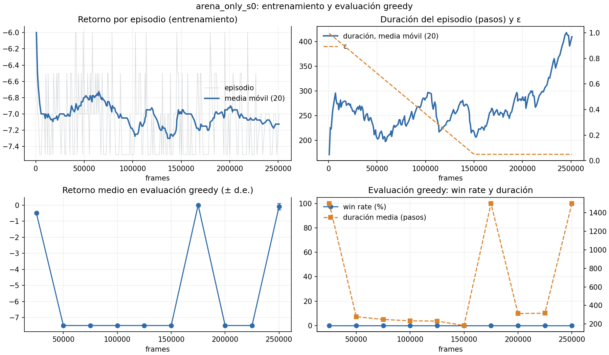

# Experimento preliminar: DDQN solo en la arena (segundo avance)

> Fecha: 2026-11-08 · Config: [`configs/arena_only.yaml`](../configs/arena_only.yaml) ·
> Resultados: `results/arena_only_s0/` (no versionado; ver `.gitignore`)
>
> **No forma parte del experimento principal** (control vs. forward vs. reverse).
> Es un experimento acotado para el segundo avance.

## 1. Motivación

La corrida de humo (`results_smoke/smoke_reverse_s0`, 80k frames) mostró que el
pipeline corre de punta a punta, pero no permitía afirmar que el agente aprende:
las actualizaciones empezaban a los 20k frames y ε seguía en 0.89 al salir de la
arena.

No se corrió una versión recortada de la comparación forward vs. reverse porque:

- con `epsilon_gate = 0.10` y `epsilon_decay_frames = 500k`, ninguna etapa puede
  superarse antes de ~450k frames. Con un presupuesto corto, forward se quedaría en
  `spawn` y reverse en `arena`: se compararían dos etapas, no dos currículos;
- el cómputo disponible es solo CPU (ver §4).

Este experimento responde a dos preguntas previas:

1. **¿El agente aprende algo en nuestro entorno?** Se mide en la etapa más corta y
   con recompensa más frecuente: la pelea contra Whispy Woods (`arena`).
2. **¿Cuántos fps reales tenemos entrenando?** Sirve para planificar las 9 corridas.

## 2. Configuración

Hereda todo de `base.yaml` (misma red, recompensa esparsa, γ = 0.997, buffer de
20k, 11 acciones) salvo:

| Parámetro | base.yaml | arena_only | Motivo |
|---|---|---|---|
| Etapas | currículo / nivel completo | solo `arena` | aislar una etapa |
| `total_frames` | 2M | 250k | tiempo disponible |
| `min_buffer_to_learn` | 20 000 | 5 000 | empezar a aprender antes (corrección propuesta nº 1) |
| `epsilon_decay_frames` | 500k | 150k | adecuado a 250k frames |
| `max_steps_per_episode` | 4000 | 1500 | ver §3 |
| Evaluación | full-level, 10 ep. cada 250k | **arena**, 10 ep. cada 25k | curva con resolución útil |
| Evaluación final | 100 ep. | 30 ep. | tiempo |
| Consolidación / muestreo mixto | 500k / 20 % | 0 / 0 % | no aplica |

Para evaluar en una sola etapa se agregó a `src/train.py` la opción
`train.eval_stage` (y `train.eval_goal`). Si no se define, la evaluación sigue
siendo full-level: los grupos del experimento principal no cambian.

Reproducir:

```powershell
python -m src.train --config configs/arena_only.yaml --seed 0
python tools/plot_run.py results/arena_only_s0
```

## 3. Intento 1 (descartado): la evaluación costaba más que el entrenamiento

El primer intento usaba `max_steps_per_episode = 4000` (el de `base.yaml`) y 20
episodios por evaluación. En la primera evaluación (25k frames) la política greedy
obtuvo **retorno −0.5 en todos los episodios**: recibía un golpe, no moría, no
ganaba y llegaba al tope de 4000 pasos (16 000 frames) por episodio. Esa evaluación
tardó **~6 min**, más que los 25k frames de entrenamiento previos (~2.5 min).

Se detuvo la corrida y se bajó el tope a 1500 pasos (~100 s de juego; una pelea
contra Whispy dura mucho menos) y la evaluación a 10 episodios. Log:
`results/arena_only_s0_intento1.log`.

**Implicancia para el experimento principal:** las evaluaciones full-level usan
10 episodios con tope de 4000 pasos (hasta 20 000 frames cada uno). Si la política
greedy se estanca igual, cada evaluación puede costar hasta 200k frames de
emulación, y la final de 100 episodios hasta 2M: tanto como el entrenamiento
completo. Hay que acotarlas antes de lanzar las 9 corridas.

## 4. Cómputo medido

- Hardware: AMD Ryzen 5 3400G (4 núcleos / 8 hilos), 14 GB RAM, **sin GPU CUDA**
  (PyTorch `2.11.0+cpu`).
- **~157 fps entrenando** (medido entre los frames 2 673 y 26 254, con
  actualizaciones desde los 5k). Sin entrenar, el entorno corre a ~1200 fps
  (~750 en arena): el costo dominante es DDQN en CPU.
- Estimación para el experimento principal (no verificada): 2M frames / 157 fps ≈
  **3.5 h de entrenamiento por corrida**, más las evaluaciones. 9 corridas en
  secuencia ≈ **32 h solo de entrenamiento**. Con 4 núcleos podrían correr 2–3 en
  paralelo (cada una usa ~1.5 GB), pero no se ha medido cuánto baja el fps de cada una.

## 5. Resultados

Corrida `arena_only_s0`: 250k frames, 235 episodios de entrenamiento, **26 min**
de reloj en total (21:12 → 21:38, evaluaciones incluidas ≈ 160 fps efectivos).
Figura generada con `python tools/plot_run.py results/arena_only_s0` (copia versionada
en `docs/figures/`):



### 5.1 Entrenamiento (por cuartos del presupuesto)

| Frames | Episodios | Retorno medio | Duración media (pasos) | Victorias | ε medio |
|---|---|---|---|---|---|
| 0 – 63k | 66 | −6.90 | 238 | 0 | 0.79 |
| 63k – 126k | 61 | −7.08 | 256 | 0 | 0.40 |
| 126k – 188k | 63 | −7.07 | 249 | 0 | 0.08 |
| 188k – 250k | 45 | −7.09 | **352** | 0 | 0.05 |

El retorno no mejora: casi todos los episodios terminan en muerte con 5 golpes
recibidos (−5 − 5 × 0.5 = −7.5). Lo único que cambia es la **duración**, que sube
de ~240 a ~350 pasos en el último cuarto: el agente sobrevive más, pero no gana.

### 5.2 Evaluación greedy en arena (10 episodios cada 25k)

| Frame | 25k | 50k–150k | 175k | 200k–225k | 250k | Final (30 ep.) |
|---|---|---|---|---|---|---|
| Win rate | 0 % | 0 % | 0 % | 0 % | 0 % | **0 %** |
| Retorno medio | −0.5 | −7.5 | 0.0 | −7.5 | −0.1 | −0.35 |
| Duración media | 1500 | 184–279 | 1500 | 313–316 | 1500 | 1500 |

La política greedy oscila entre **dos modos**: morir rápido (−7.5, ~250 pasos) o
**esconderse hasta el timeout** (≈ 0, 1500 pasos). La política final se esconde.

### 5.3 ¿Hay señal contra el jefe? (`tools/probe_boss_damage.py`)

Política aleatoria, 60 episodios en arena:

| Golpes a Whispy (de 6) | 0 | 1 | 2 | ≥ 3 |
|---|---|---|---|---|
| Episodios | 44 | 11 | 5 | 0 |

El 27 % de los episodios aleatorios daña al jefe, pero ninguno pasa de 2 golpes.
Ganar por azar (6 golpes) es prácticamente imposible.

## 6. Conclusiones

1. **El agente no aprende a ganar la arena con recompensa esparsa en 250k frames.**
   En 235 + 49 (humo) episodios nunca observó la recompensa de victoria, así que
   DDQN solo puede aprender a evitar penalizaciones.
2. **Con la recompensa actual, esconderse es racional.** Un timeout vale 0 y morir
   −5: la política aprendida converge a sobrevivir sin atacar. Es un óptimo local
   que la recompensa premia.
3. **Esto cuestiona una premisa del currículo inverso.** Reverse asume que la
   primera etapa (arena) es resoluble con la política actual. Hoy no lo es: el
   currículo inverso empezaría atascado en su primera etapa, y el forward en la
   última.
4. **Sí existe señal aprovechable**: el jefe recibe golpes por azar (27 % de los
   episodios). La recompensa simplemente no la ve.

### Correcciones propuestas (a discutir con el equipo)

| Opción | Qué cambia | Costo para la validez experimental |
|---|---|---|
| **A. Inicio más cerca de la meta dentro de la arena** (Florensa): save states con Whispy a 1–2 de vida, y luego 4, y luego 6 | Una sub-escalera dentro de la arena; la recompensa sigue esparsa | Bajo: es el método original de reverse curriculum. Hay que decidir si forward también la usa |
| **B. Recompensa por golpe al jefe** (p. ej. +1 por cada punto de `boss_hp` perdido) | Shaping mínimo, solo en etapas con jefe | Medio: rompe "sin shaping", pero idéntico en los 3 grupos |
| **C. Penalizar el timeout** (p. ej. −5, igual que morir) | Elimina el óptimo local de esconderse | Bajo; no da señal para ganar por sí sola, combinar con A o B |
| **D. Más presupuesto** | Nada | Alto en cómputo y poco probable que alcance (2 de 6 golpes por azar) |

Recomendación: **A + C**. A mantiene la recompensa esparsa y es literalmente la
idea de Florensa; C quita el incentivo a esconderse. Antes de las 9 corridas,
repetir este experimento corto con esa corrección y comprobar que aparece al menos
una victoria.

### Correcciones al experimento principal derivadas de este experimento

- Acotar la duración de las evaluaciones (§3): con el tope actual, la evaluación
  final de 100 episodios podría costar tanto como el entrenamiento.
- Usar ~160 fps (CPU) para planificar: ~3.5 h por corrida de 2M frames.
- `min_buffer_to_learn = 5000` funcionó sin problemas; adoptarlo en `base.yaml`.
